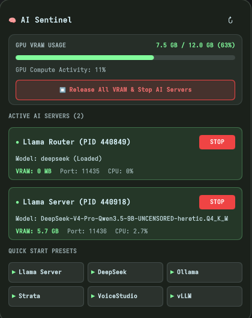
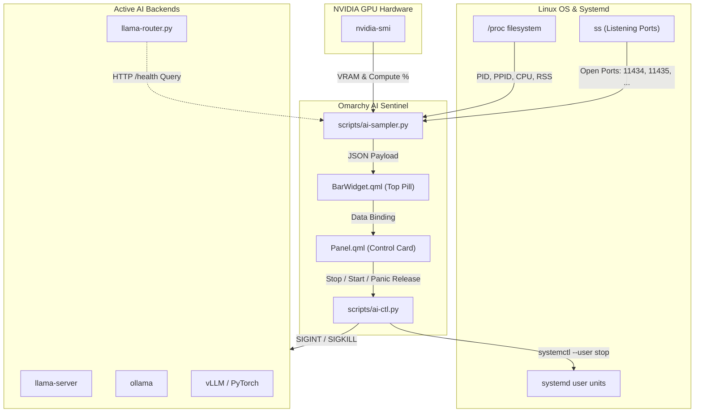

# AI Sentinel 🧠

> **The Intelligent Local AI Supervisor & VRAM Sentinel for Omarchy Linux.**  
> Monitor, orchestrate, and liberate GPU memory across local LLM engines with a single click directly from your desktop bar.

[](https://omarchy.org)
[](https://github.com/777Business/Omarchy-AI-Sentinel)
[](LICENSE)
[](https://developer.nvidia.com/cuda-toolkit)

---

<p align="center">
  
</p>

---

## The Problem

When running modern local AI backends (**llama-server**, **llama-router**, **Ollama**, **vLLM**, or autonomous agent harnesses like **DeepSeek Harness / dsh**), local LLMs often occupy 6 GB to 16+ GB of GPU VRAM silently in the background. 

Leaving an unmanaged model loaded consumes power, throttles system graphics, and causes immediate **CUDA Out-Of-Memory (OOM)** crashes when launching video editors, games, 3D suites, or secondary model tests. 

**AI Sentinel** solves this permanently by integrating directly into your Omarchy status bar:
- **Know at a glance** exactly which models are loaded and how much VRAM they consume.
- **Inspect** model names, PIDs, listening ports, CPU %, and systemd service units.
- **Liberate VRAM instantly** with granular per-server stops or a single **Panic VRAM Release** button.

---

## ✨ Key Features

### 🔍 Zero-Config Auto-Discovery & Model Introspection
AI Sentinel runs a non-blocking asynchronous sampler that continuously inspects active compute processes, networking sockets, and GPU hardware metrics.
- **Model Name Extraction**: Automatically queries endpoint metadata or command-line weights flags (`-m`, `--model`) to show the friendly model name (e.g. `DeepSeek-V4-Pro-Qwen3.5-9B`, `Qwen3.8-35B-A3B`).
- **Dynamic Router Support**: Native integration with dynamic LLM proxies and routers (`llama-router`), distinguishing between loaded standby states and active inference sessions.
- **Universal GPU Fallback**: Catches *any* custom PyTorch, JAX, or CUDA process consuming GPU compute memory while filtering out desktop utilities (browsers, video editors, shell).

### 📊 Real-Time VRAM & Compute Telemetry
- **Hardware-Accurate Metrics**: Uses sub-millisecond `nvidia-smi` sampling to display total GPU VRAM used, available headroom, and real-time compute utilization percentage.
- **Non-Duplicated Tracking**: Aggregates per-process VRAM accurately without double-counting parent/child process groups.
- **Proactive 85% Warning**: The bar pill dynamically transitions to warning mode when VRAM pressure exceeds safe operating thresholds, preventing unexpected OOM kernel kills.

### 🛑 One-Click Lifecycle Management & Systemd Integration
- **Granular Server Stop**: Terminate individual runaway backends directly from their dedicated card.
- **Systemd Unit Awareness**: Detects if an AI server is supervised by `systemd` (e.g. `llama-server.service`, `ollama.service`). Stopping a service unit cleanly issues `systemctl --user stop`, preventing systemd from auto-respawning it behind your back.
- **Graceful SIGINT Termination**: Sends clean shutdown signals before falling back to forceful kills, eliminating model unload core dumps.

### 🚨 Instant Panic "Release All VRAM"
Need to quickly launch a demanding game, render a video timeline in FilmCraft / DaVinci Resolve, or spin up a new agent cluster? Tap **Release All VRAM & Stop AI Servers** to instantly terminate all AI processes and flush GPU memory to pristine desktop baseline.

### 📌 Expanded Quick Start Grid & Custom Preset Pinning
- Comes pre-configured with a responsive launcher grid for:
  - **Llama Server**: High-performance local llama.cpp GGUF server & router (`systemctl --user start llama-server.service`).
  - **DeepSeek**: DeepSeek Autonomous Harness web environment (`dsh web`).
  - **Ollama**: Universal local model daemon (`ollama serve`).
  - **Strata**: Multi-GPU split-inference engine (`strata launch`).
  - **VoiceStudio**: Dedicated RTX 3060 CUDA audio backend (`systemctl --user start voicestudio.service`).
  - **vLLM**: Production high-throughput inference engine (`vllm serve`).
- **Dynamic Pinning & Unpinning**: Discovering an unlisted AI engine or custom script? AI Sentinel provides an inline **PIN** action to permanently register the command into your custom presets, complete with one-click removal (`×`).

### 🎨 Native Omarchy & Quickshell Integration
Built with pure Qt Quick / QML following the official Omarchy Quattro design language:
- Harmonizes with active desktop palette, corner radii, and spacing scales.
- Exposes full **ShellIpc** remote targets (`open`, `close`, `toggle`, `refresh`).

---

## 🛠️ Supported AI Backends

| Engine / Framework | Detection Method | Model Introspection | Service Management |
| :--- | :--- | :--- | :--- |
| **llama-server / llama.cpp** | Binary & Process Name | Path / Name Parsing | Process Group / Systemd |
| **llama-router** | Port 11435 & Health API | Dynamic On-Demand / Loaded | `systemctl --user` |
| **Ollama** | CLI / Service (`ollama serve`) | Active Loaded Model API | `systemctl` / Process |
| **vLLM** | Python module / CLI `--model` | Hugging Face ID / Path | Process Group |
| **Strata Engine** | Native process invocation | Weight filename | Process Group |
| **KoboldCPP** | Executable pattern | Weight filename | Process Group |
| **Text Generation Inference (TGI)** | Process arguments | Model repository ID | Container / Process |
| **LM Studio / LocalAI / TabbyAPI** | Binary signature | Active session | Process Group |
| **Generic PyTorch / CUDA Compute** | GPU memory heuristic | Process commandline | PID Termination |

---

## 📥 Installation

### Method 1: Using the Omarchy Plugin CLI (Recommended)
Add and enable the plugin directly in your Omarchy environment:

```bash
omarchy plugin add https://github.com/777Business/Omarchy-AI-Sentinel.git --enable --section right
```

### Method 2: Manual Git Clone
Clone directly into your Omarchy plugins directory:

```bash
cd ~/.config/omarchy/plugins
git clone https://github.com/777Business/Omarchy-AI-Sentinel.git
omarchy plugin enable omarchy-ai-sentinel --section right
omarchy restart shell
```

---

## 🎮 Desktop Keybinding & IPC Control

AI Sentinel exposes native `ShellIpc` bindings. You can bind a keyboard shortcut in Hyprland to toggle the panel on demand:

Add to your `~/.config/hypr/hyprland.conf`:
```ini
# Toggle AI Sentinel overlay
bind = $mainMod, A, exec, quickshell ipc -p ~/.local/share/omarchy-quattro/shell/shell.qml call omarchy-ai-sentinel toggle
```

Available IPC endpoints:
```bash
# Toggle the flyout panel
quickshell ipc -p ~/.local/share/omarchy-quattro/shell/shell.qml call omarchy-ai-sentinel toggle

# Open panel
quickshell ipc -p ~/.local/share/omarchy-quattro/shell/shell.qml call omarchy-ai-sentinel open

# Close panel
quickshell ipc -p ~/.local/share/omarchy-quattro/shell/shell.qml call omarchy-ai-sentinel close

# Force refresh hardware and process telemetry
quickshell ipc -p ~/.local/share/omarchy-quattro/shell/shell.qml call omarchy-ai-sentinel refresh
```

---

## ⚙️ Architecture & Dataflow



---

## 📁 Repository Structure

```
Omarchy-AI-Sentinel/
├── BarWidget.qml       # Omarchy bar widget, status dot, and background sampler process
├── Panel.qml           # Floating flyout control panel with VRAM gauge and server list
├── manifest.json       # Omarchy Plugin Schema v1 manifest
├── preview.png         # High-resolution screenshot preview
├── scripts/
│   ├── ai-sampler.py   # Asynchronous telemetry & process inspector
│   └── ai-ctl.py       # Action dispatcher for starting/stopping servers & presets
└── README.md           # Documentation
```

---

## 🔧 Configuration & Custom Presets

User custom presets are persisted in standard JSON format at:
```
~/.config/omarchy-ai-sentinel/custom_presets.json
```

Example configuration:
```json
[
  {
    "id": "deepseek-local",
    "name": "DeepSeek 9B",
    "pattern": "llama-server",
    "cmd": "~/.local/bin/llama-server.sh"
  }
]
```

---

## 🗑️ Removal & Disabling

```bash
# Temporarily disable without removing
omarchy plugin disable omarchy-ai-sentinel

# Permanently remove
omarchy plugin remove omarchy-ai-sentinel --yes
```

---

## 🤝 Contributing

Contributions, bug reports, and pull requests are welcome! If you use an AI engine not currently recognized by default, feel free to submit an issue or open a PR extending `scripts/ai-sampler.py`.

---

## 📄 License

Distributed under the **MIT License**. See [LICENSE](LICENSE) for details.  
Crafted with ❤️ for the **Omarchy Linux** ecosystem.
